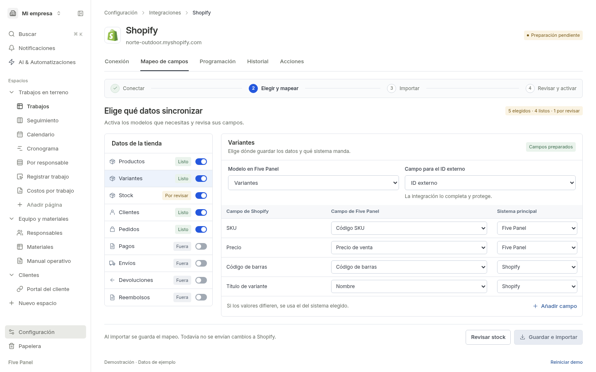
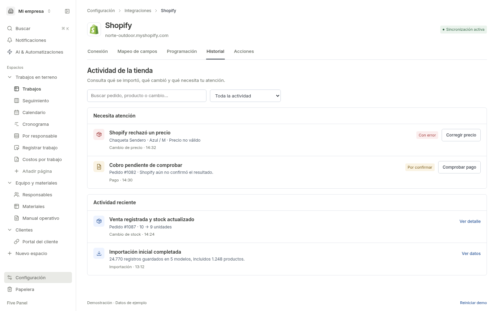

# Shopify #279 designs

These are the final designs recovered from Paseo agent `c69a9494-0dc7-4e52-92e5-fba3461aec79`, including its later history and batch-import changes. They accompany the [spec](../279-create-integration-shopify.md) and [implementation plan](../../docs/superpowers/plans/2026-11-11-shopify-integration.md).

- [Interactive prototype](https://five-pane-dev-server.tail7d89bf.ts.net/c/J88FjcHO5C/proto?frame=VUYT7ICyJS)
- [Doop canvas](https://five-pane-dev-server.tail7d89bf.ts.net/c/J88FjcHO5C?frame=VUYT7ICyJS), page `zp_Uo9vkUL`

The PNGs below are repository copies of the final renders from `shopify-279-prototype-v2`. They remain available without access to Doop. Numbers, names, times, and enabled models in the screens are example data.

## Screens

| Screen | Saved design | Doop frame | Required behavior |
| --- | --- | --- | --- |
| Connection | [connect.png](connect.png) | `VUYT7ICyJS` | Connect the store to the current business; no company chooser. |
| Field mapping | [mapping.png](mapping.png) | `lF-w47FKu0` | Select models, destination fields, external IDs, field owners, and stock locations; show readiness. |
| Import progress | [importing.png](importing.png) | `iRSviSIDC8` | Save and import once; leave and return without losing progress. |
| Review and activation | [review.png](review.png) | `W9vuLtKqL5` | Show record counts and samples, ownership, schedule, and actions before explicit activation. |
| Schedule | [schedule.png](schedule.png) | `hv0l4hVXAQ` | Configure event handling and scheduled checks; preserve the current setup phase. |
| Actions | [actions.png](actions.png) | `vsyHfrcj9u` | Configure defaults and open a related order to perform an action. |
| Order cancellation | [cancel.png](cancel.png) | `ID1IL28Ibm` | Open order, review restocking, notification, and reason, then confirm. Explain the separate refund. |
| Business activity | [history.png](history.png) | `cJKSK_GsU_` | Show business results, one initial-import activity, and useful follow-up actions. |
| Execution details | [execution.png](execution.png) | `-HdlEAYNEE` | Open the shared viewer for runs, batches, steps, inputs, outputs, errors, and attempts. |
| Price repair | [repair.png](repair.png) | `WixSssQs3-` | Open the affected variant, correct it, and return to the same activity. |
| Payment verification | [payment.png](payment.png) | `OXaCYDg3Wm` | Check an uncertain result before offering a safe retry. |
| Disconnection | [disconnect.png](disconnect.png) | `ZegunwU2g6` | Stop future requests and reconnect the same store without losing setup. |
| Mobile review | [mobile.png](mobile.png) | `JslXqM79CD` | Keep all tabs and activation reachable at 390 px. |

## Agreements from the conversation

- Flow: **Connect → Map → Import → Review → Activate**. Changing tabs never activates sync or advances setup.
- Keep the existing Five Panel shell, compact controls, white surfaces, and blue primary actions. Use the application's theme tokens and translations in implementation.
- Import belongs in Field mapping, with one **Save and import** action. Selected models with incomplete mappings block that action.
- History is a reusable business activity view. **View execution** opens a separate reusable technical viewer; both use the same saved execution data.
- One import can have many batch executions. For example, 1,248 products at 250 per batch take five executions, while remaining one activity. These counts are illustrative.
- The final batch agreement is **read → save → enqueue**. `save_batch` returns `nextExecution`; the separate generic `automation.enqueue` step receives it. `null` means no further execution. Pass `importId`, `cursor`, and `limit` explicitly, using English JSON fields and step names.
- The screenshots illustrate the Shopify preset. The generic HTTP connection and custom-action editor discussed in the main conversation are also required by the spec; these thirteen screens do not provide a separate design for those controls.

## Validation provenance

The design agent recorded **29 prototype interaction checks at each of 1440 and 390 px**. They covered setup state, mapping requirements, import/review, activation/pause, cancellation, history, samples, price repair, payment verification, reconnection, keyboard use, and focus return.

Those checks used mock data and simulated work in rendered prototype HTML. They do not prove Shopify authorization, API calls, database transactions, queue recovery, or application behavior. The execution drawer groups work by model; implementation must also let users inspect the actual read, save, and enqueue steps inside each batch.

## Preview

